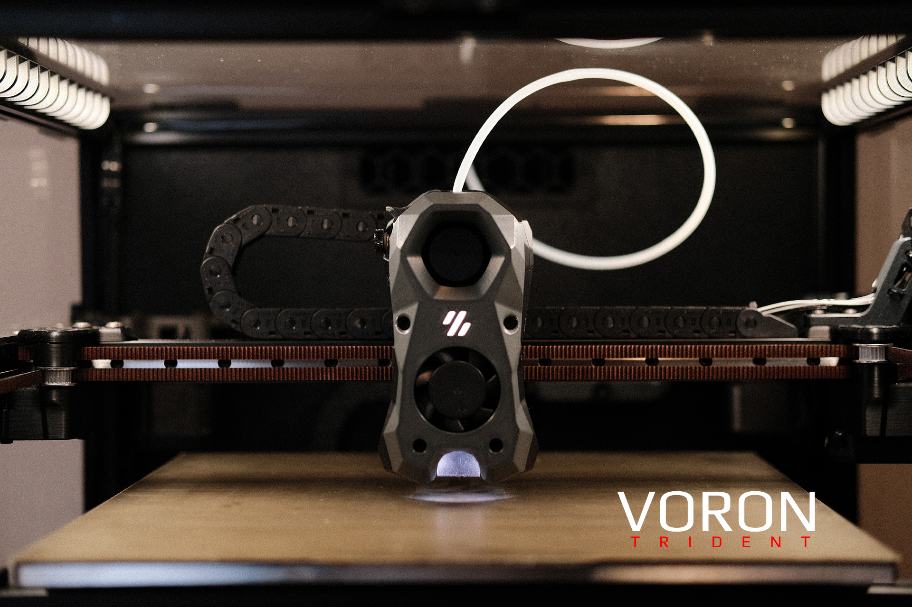

# Voron Trident
### Download the STLs

The official release of the Voron Trident 3D printer.  You can find the Bill of Materials in the configurator located at the [Voron Design]( http://vorondesign.com/voron_trident) web site.  The recommended sizes for this printer are 250x250x250, 300x300x250 and 350x350x250.
